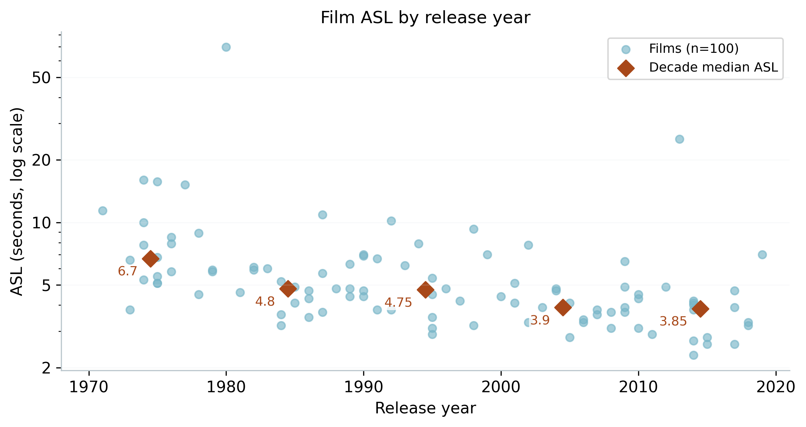
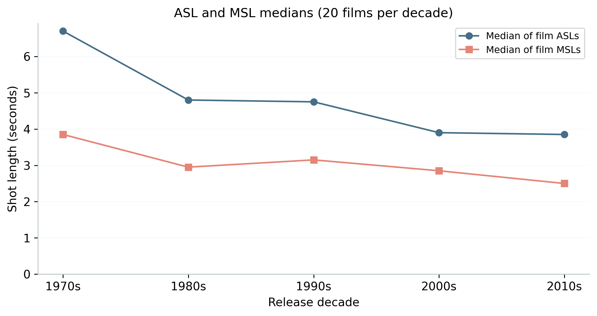

# Film Editing Pace Across Decades

A reproducible Python project combining API collection, HTML parsing, data validation, text features, association rules and visual analysis.

## Project Overview

A cut is a countable event in a film, which makes shot length a practical way to study one aspect of editing pace. This project combines published shot measurements with film metadata to compare 100 films released from 1970 to 2019. It follows the data from web acquisition and identity checks through mining and visualisation.

**Average shot length (ASL)** divides measured duration by shot count. **Median shot length (MSL)** describes the middle shot duration within a measurement. A few long takes can pull the mean upward, so the two measures offer different views of the same film.

## Research Questions

1. **RQ1. How does the typical film ASL vary across different decades?** Take one ASL per film and calculate the median across the 20 films in each decade.
2. **RQ2. Do similar changes in editing pace occur within selected film genres?** Compare decade ASL medians for Adventure, Drama and Thriller. Each has at least three films per decade. A film can contribute to several genre groups.
3. **RQ3. Do ASL and MSL provide consistent assessments of changes in film editing pace?** Compare the decade medians of the two film-level measures using the same selected pages.

## Data Sources

| Source | Acquisition method | What it supplies |
| --- | --- | --- |
| TMDB | REST API, JSON responses | Release dates, ratings, vote counts, genres, reference runtimes, directors and synopses |
| Cinemetrics | Directory lookup, then HTML requests and BeautifulSoup parsing | Measurement page IDs, shot counts, measured durations, ASL, MSL and contributor notes |

Title and year identify candidate pages. Collection then checks the year and IMDb ID, or uses title, year and director when the IMDb match is unavailable. Each frozen film retains its TMDB ID and selected Cinemetrics page ID so the measurement can be traced back to its source.

## Dataset Overview

| Stage | Size | Unit |
| --- | ---: | --- |
| TMDB candidate pool | 260 | Distinct films |
| Merged measurement table | 505 rows × 48 fields | One parsed measurement page joined to film metadata |
| Films covered by those pages | 160 | Distinct TMDB IDs before final selection |
| Frozen analytical sample | 100 rows × 7 fields | One film and its selected page per row in the frozen CSV |
| Decade groups | 5 × 20 films | 1970s through 2010s |

The data passport records the collection totals. The 48 parsed fields comprise 37 structured scalars, eight lists and three free-text fields. The compact archive contains the full TMDB cache, directory responses, all parsed rows and request logs, 20 measurement HTML examples, and the separate Titanic demo HTML.

## Project Workflow

**Demo → Selection → Collection → Analysis → Results**

1. **Demo** follows a single Titanic page from its HTML buttons to an arithmetic check on ASL.
2. **Selection** reads ranked TMDB pages and enriches eligible films with detail and credit records.
3. **Collection** follows directory links, screens page measurements and selects one qualifying page per film.
4. **Analysis** joins the frozen film/page pairs to genres and synopses, audits the sample and runs the text, genre and aggregation analyses.
5. **Results** brings the three questions together in M6. In this sample, the decade median film ASL falls from **6.70 seconds** in the 1970s to **3.85 seconds** in the 2010s. The scatterplot shows how much individual films vary around those medians. [Results and figure index](figures/index.md)





## Notebook Guide

| Notebook | Responsibility |
| --- | --- |
| [Titanic Demo](Titanic_Demo.ipynb) | Trace one measurement from source to result |
| [Film Selection](Film_Selection.ipynb) | Build the vote-ranked candidate pool |
| [Film Collection](Film_Collection.ipynb) | Screen measurements and reproduce the frozen sample |
| [Film Analysis](Film_Analysis.ipynb) | Run the data-quality checks, experiments and research comparisons |

**Titanic Demo**

- Read the film heading and extract NoS (shot count), LEN (measured duration), ASL and MSL.
- Convert LEN to seconds and remove the thousands separator from NoS. Dividing 11,205.6 by 2,673 gives 4.19 seconds per shot, consistent with the displayed 4.2.

**Film Selection**

- Apply the same cutoffs in every decade: rating ≥ 7.0 and at least 1,000 votes. Read candidates in descending vote-count order.
- Replay 2, 2, 3, 2 and 4 list pages respectively. Remove cross-page repeats, read details and check candidate IDs and order against the saved pool.

**Film Collection**

- Check identity, exclude excerpts and invalid measurements, and require measured duration to fall within 90–110% of the TMDB reference runtime.
- Among passing pages for one film, choose the duration ratio closest to one using full precision, then page ID in ascending string order for ties. The American Beauty example shows the choice.
- Compare frozen pairs and exclusion reasons with the archive. Reparse the 20 raw examples and compare all four statistics, their URLs and original request hashes. On selected sample pages, recheck ASL arithmetic at the displayed precision.

**Film Analysis**

- **M1–M2** profile volume, variety and acquisition speed, classify fields, and audit missingness, outliers and repeated measurements. Counting all passing pages raises the 1970s ASL median from 6.70 to 11.30 seconds for the same films.
- **M3–M4** construct film features, compare candidate pages and process synopses into count and TF-IDF matrices. The main Apriori run uses a minimum count of 10 out of 100 films. A separate sweep uses counts of 2, 5, 10, 15, 20 and 30. The five-film check uses a minimum count of 2. Results include the Top 10 rules and all 12 Adventure rules. The table shows fresh single-call timings. Figure 8 uses the saved timings for the same six thresholds.
- **M5–M6** run Map, Shuffle, Combiner and Reduce directly in notebook cells. The decade **means** are checked against pandas, and shuffle cost falls from 100 to 35 records in the local simulation. M6 returns to the **medians** used for RQ1–RQ3.

## Technical Stack

| Task | Tools |
| --- | --- |
| Run the notebooks | Python 3.13, JupyterLab, IPython kernel |
| Acquire and parse | requests, BeautifulSoup |
| Join, audit and aggregate | pandas, NumPy |
| Prepare text and mine patterns | NLTK, scikit-learn, SciPy sparse matrices, mlxtend |
| Plot and export figures | Matplotlib |

## Project Structure

```text
.
├── README.md
├── Titanic_Demo.ipynb
├── Film_Selection.ipynb
├── Film_Collection.ipynb
├── Film_Analysis.ipynb
├── requirements.txt
├── data_compact.zip        Cached inputs for all four notebooks
├── data/frozen_films.csv   Browseable copy of the 100-film sample
└── figures/                Eleven final charts and their index
```

The notebooks read the archive directly. It contains source responses and logs,
frozen tables, a data passport, and saved text matrices and experiment results.
The CSV outside the archive is an identical copy for quick inspection.

## How to Run

1. Clone this repository or download and extract its ZIP from GitHub. Open a terminal in the folder containing the four notebooks, `requirements.txt` and **data_compact.zip**. Leave the inner archive zipped.
2. With Python 3.13, install the pinned dependencies and launch JupyterLab from that folder.

   ```shell
   python -m pip install -r requirements.txt
   python -m jupyterlab
   ```

3. For the full walkthrough, open **Demo → Selection → Collection → Analysis**. In each notebook select the Python kernel and run **Restart Kernel and Run All Cells**. Each reads its own inputs from disk. To reproduce the research results directly, open Film Analysis and run it from the top.
4. Selection and Collection replay saved responses by default. Titanic Demo reads the saved page by default. To demonstrate a real request, set `live_demo = True` in its first code cell. It records the response or failure separately. Analysis runs offline.

For an optional fresh TMDB page, set `TMDB_READ_TOKEN` in your local environment before launching Jupyter, or in a local `.env` beside the notebooks. In Selection, enable `online_demo=True`. Keep credentials local. The default candidate replay needs no token.

## Limitations

The merged table contains 505 measurements across 160 films; the analytical sample contains 100 films. Vote ranking, rating cutoffs, Cinemetrics coverage and decade quotas favour popular films with available measurements. Results describe this purposive sample and support observational comparisons.

Runtime and arithmetic checks catch some incomplete or inconsistent measurements. The sources record runtimes and contributor notes. Edition, playback speed and exact cut boundaries limit comparisons. M3.6 counts pairs with equal title tokens and a duration similarity of at least 90%. Matching IDs confirm repeated measurements of one film. Whether two contributors measured the same edit and shot boundaries remains unknown.

**Credits and assistance.** This product uses the TMDB API but is not endorsed or certified by TMDB. Shot measurements come from Cinemetrics contributors. I ran the Python collection scripts on my own computer. For the Cinemetrics measurement pages, the scripts made 513 HTTP attempts and received 505 successful responses. Codex helped draft and debug the collection and parsing code. The collector labels in the archived logs record this development assistance. Codex also assisted with notebook organisation, validation and figure preparation. Checks used cached HTML, frozen pair hashes, saved matrices and experiment outputs. The original MapReduce functions and threshold loop are preserved.

**Figure sources.** The acquisition window is recorded in [the figure index](figures/index.md). Individual figures retain their units, legends and interpretation notes.
